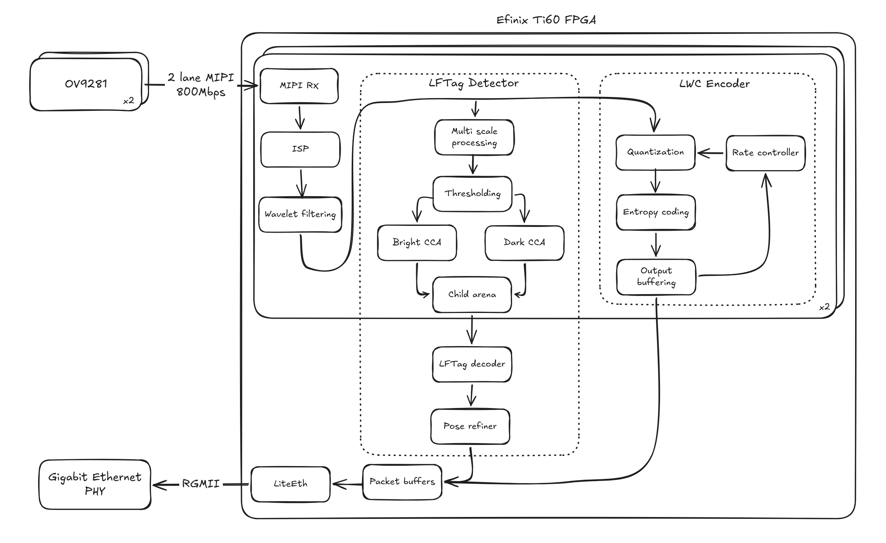
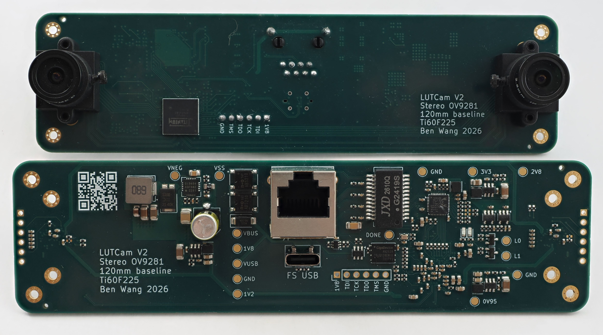
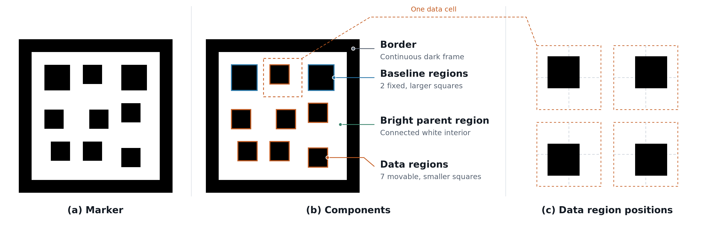
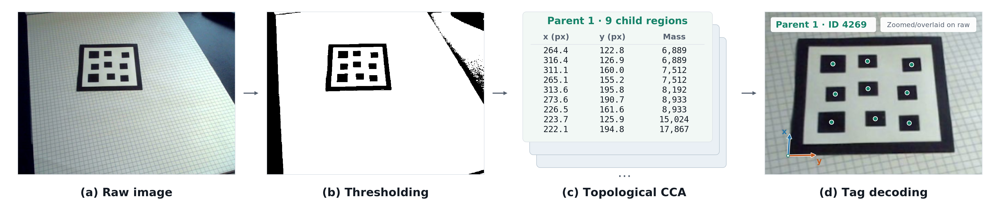
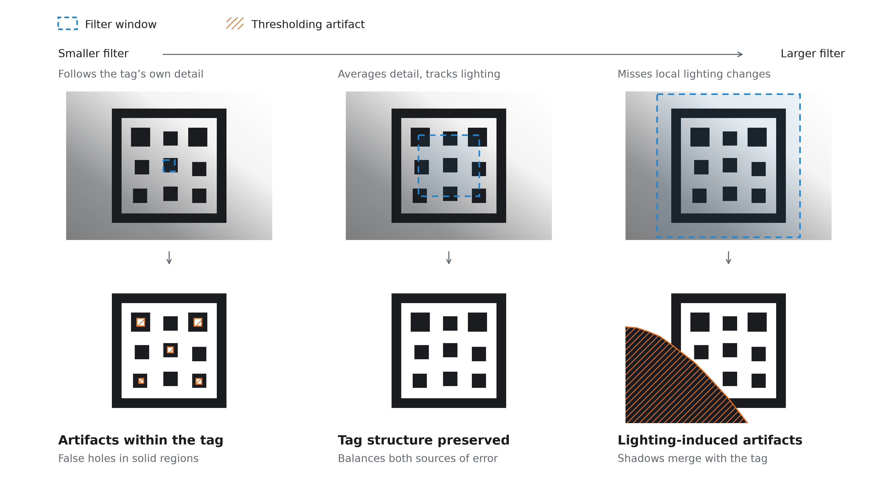
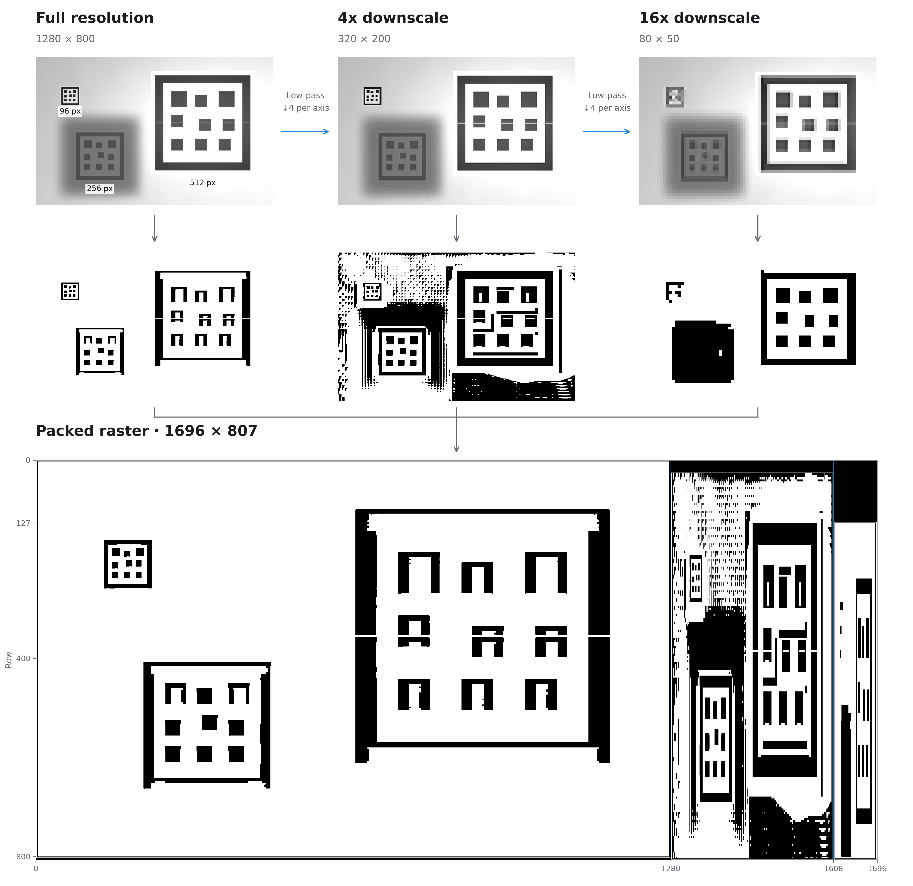
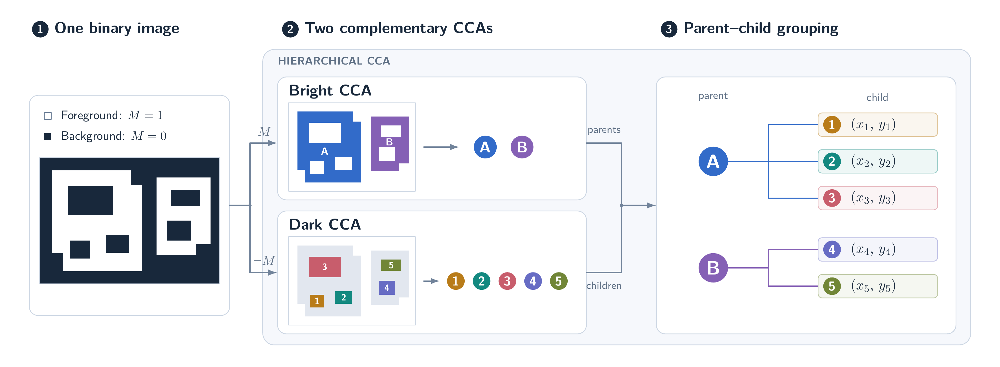
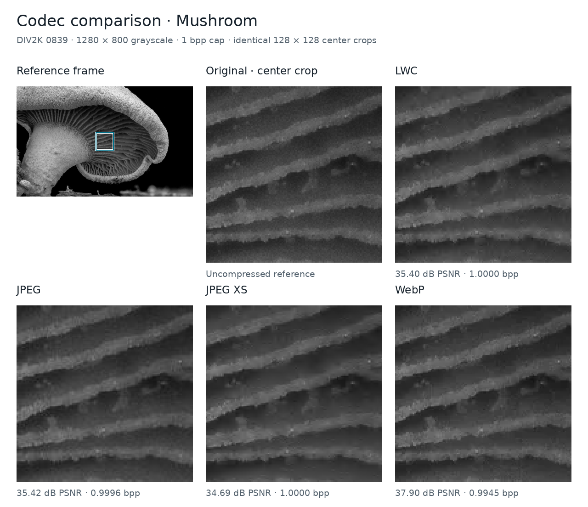
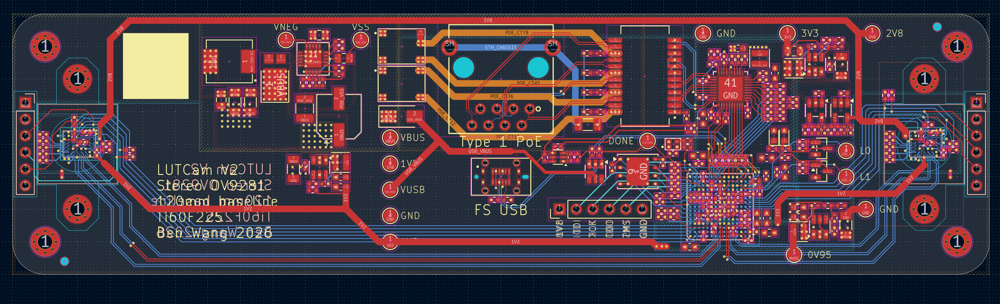

Fiducial markers are often used in robotics to determine the relative positions of objects or to localize the camera.
Usually fiducial markers are not used in the actual control loop, as the detection and pose estimation usually runs on a CPU
with variable latency. Additionally, achieving real-time performance usually requires some combination of reduced
resolution, lowered frame rates, or powerful processors.
With FPGAs and a fiducial marker designed for streaming processing, it's possible to achieve a unique combination of
high resolutions, high frame rates, low latency and  low power consumption.

I designed and built a board with an Efinix Titanium Ti60 FPGA and two OV9281 sensors as a proof of concept, and show
how it's possible to achieve full-rate fiducial marker detection, decoding and pose estimation at 1280 × 800 at 120 fps
(~240 MPixel/s, no downsampling). A custom FPGA-optimized fixed-bitrate (≤ 1 bit per pixel) image codec is also
implemented in the design to stream full resolution video out of the cameras. The combined design only consumes
~1 W total including the camera sensors and Ethernet PHY when powered from USB.

 Architecture block diagram 

 PCB photos 

<video controls style="max-width: 600px; outline: none">
<source src="/assets/lftag%20demo.mp4" type="video/mp4">
Your browser does not support the video tag.
</video>

 End-to-end demo 

The full design (hardware, gateware, software) is open source and available [here](https://github.com/kingoflolz/lutcam/tree/main).
This blog post was written by me (a human 😁), with some diagrams made with AI. The gateware and software were written entirely by AI.

# Fiducial Marker Design

The primary challenge for designing a fiducial marker is to create a design which:

- is easy to detect under projective transforms
- supports many unique markers within a family
- has a low false-positive rate in natural images

Each different fiducial design has a different way of solving each of these problems. For example, we can look at
AprilTags, which are probably the most commonly used markers. The original AprilTag detection pipeline starts by detecting quadrilaterals
in the image, since a square remains a quadrilateral under perspective changes. This is further broken down by first detecting
lines and then joining them into quads. Marker data is then read from the binary grid pattern within the square, and
false positives are avoided by only using patterns which are uncommon to occur naturally in the environment (e.g., single
color or squares).

[LFTag](https://arxiv.org/abs/2006.00842) is a fiducial marker design I created in 2020, which uses hierarchical connected component analysis as the first pass (as
connected components and their parent/child relationships are invariant across projective transforms). The marker data is
then encoded within the relative locations of the marker elements. A low false-positive rate is achieved with
geometric constraints between the marker elements. [The paper](https://arxiv.org/abs/2006.00842) discusses this in more detail and also compares the
different design tradeoffs between different tags.

 LFTag marker components 

The most important feature of this marker design is that the detection can be done in a single-pass raster stream, which
makes it particularly suitable for high-throughput FPGA processing. The key constraint for FPGA designs is that there
is very little on-chip memory (the Ti60 used here only has ~300 kB of memory total!), so being able to do a fully
streaming architecture is key.

The high-level architecture of the streaming detector is:

- Local thresholding
  - Convert the grayscale image to a binary one
- Streaming hierarchical connected component analysis
  - Convert the binary image to a list of bright components, each containing a list of the dark components which it encloses
- Tag decoding
  - From the metadata of each component (centroid, size), verify and decode the tag ID

 LFTag decoding at a high level 

# Thresholding

Thresholding is done on the image to convert the grayscale image into binary (either light or dark). The threshold for
each pixel is dynamically computed based on the surrounding pixels, to deal with differing lighting across the frame.
Doing this is straightforward if the frame is buffered in memory, as you can just compute a filtered version of the
image and then compare it to the buffered frame. However, the FPGA only has 2.6 megabits of memory, or
only enough for roughly one-third of a single uncompressed frame, so this design isn't possible.

The design chosen here is to compute the filter online. Due to the dependencies of the filter, the output is delayed
relative to the input. The raw pixels are buffered for this delay, so when the filtered value is ready, it can be used
as the threshold.

The design uses a combination of a CDF 5/3 wavelet (which is also shared with the image codec) and some box averaging stages.
The filter is asymmetrical between vertical and horizontal filtering, as vertical filtering is much more expensive
due to needing to store additional full image rows.

For all thresholding techniques, there's a tradeoff for how large the filter is. The optimal filter size is slightly smaller
than the size of the tag, so that all the tag features can be detected reliably. If the filter size is too large, it
could have issues with varying lighting, and if it's too small, there can be artifacts within the tag or tag elements
joined together.

 Adaptive thresholding filter size tradeoff 

This is tricky when the tag size is unknown, so this design also performs multiscale detection, where both the raw image
and downsampled images are processed.
The raw image and the images downsampled by 4× and 16× per axis are combined into a single image, so the same pipeline can be
time-multiplexed between the different resolutions by just clocking it slightly higher.

 Multiscale detection example 

# Streaming Hierarchical Connected Component Analysis

To detect tags, we are looking for bright regions which contain 9 (or more) dark regions. If a bright region has fewer
than 9 dark regions, it cannot be a valid marker. If there are more, it could still be a marker, with some dust or
noise, so we want to keep the largest 9 regions.

## High-throughput connected component analysis

Before we worry about parent/child relationships, how can we actually detect the components at a high enough speed?
During readout of a single row, the pixels come in from
each camera at 160 MPixel/s. Averaged across the horizontal blanking interval, the pixel rate is still 140 MPixel/s. After
the multiscale processing, the pixel rate goes back up to 186 MPixel/s. Performing connected component analysis at this
rate is a significant challenge. Existing FPGA connected component analysis designs in the literature top out at ~150 MPixel/s, require
multiple blocks whose results must be combined across boundaries, or make simplifications akin to downsampling.

A modified version of the [LinkRunCCA](http://dx.doi.org/10.1007/s11554-016-0590-2) algorithm was created, which performs the full connected component analysis at two
pixels per clock, adding the bypassing and hazard handling necessary to do this correctly. Additional pipeline
stages were also needed to close timing at 120 MHz in the full design. With a 120 MHz clock and 2 pixels per clock, this
is able to process the image at full resolution.

The output of the connected component block is a feature vector which contains information about the connected
component, such as bounding box, area, etc. This output is streaming, and the feature vector is output when the
component is completed.

## Combining into hierarchical relationships

 Combining two CCA blocks into hierarchical CCA 

To perform hierarchical
connected component analysis, two CCA blocks are combined. One treats bright pixels as foreground and one treats dark
pixels as foreground. The dark components have feature vectors to compute their centroids (mass + first-order x/y moments).

When a dark component is finished, the bright component which "finishes" it is the component which is its parent. To
store this parent/child relationship as well as the actual feature vector, a new module is added which uses a linked
list to store the children for each bright component. The feature vector for the bright component just consists of a
pointer to the head of this linked list.

This linked list needs to support the following operations:

- Adding a new child to the list and truncating to the top 9
- Merging two lists and truncating to the top 9
- Reading out lists when the bright component finishes

This module is implemented with an FSM-driven dual-port BRAM. The lists are stored in sorted order, with the head being
the smallest element.
This allows elements which are smaller than the current smallest element to be rejected immediately at the input for a full list,
without further linked list traversal. The sorted ordering also allows the merging to be fast. Even then, a merge of two
full lists is still quite expensive, taking 46 cycles. Fortunately, geometric constraints enforce how often this type of
merge can occur, and with some throughput optimization, this part can handle 2 pixels per clock like the rest of the
pipeline, except for particularly adversarial inputs which are not expected in practice.

Also, to reduce storage of this block, the feature vectors for the dark regions are compressed after they are completed,
but before they are inserted into the arena. The mass and first-order x/y moments are necessary when adding pixels or merging
features, but it's much more efficient to store the centroid directly. The raw feature vector is 94 bits (26-bit mass,
35-bit X moment, 33-bit Y moment), and is compressed to 38 bits (8-bit log mass, 15-bit X centroid, 14-bit Y centroid)
using normalization and a lookup-table-based reciprocal approximation.

# Tag Decoding

An FSM drives several processing blocks that implement the tag decoding process from the input centroids. A general-purpose
processor would probably work here, but this design is able to achieve higher throughput due to not having to spend
instructions/cycles on control logic. A 64-bit RISC-V implementation would take on the order of 10× the instructions,
and with a low-area FPGA processor implementation, likely take >50× the cycles.

The stages of the tag decoding are:

- Corner selection
  - Identify the two largest regions as the baseline regions, then analyze the remaining points to figure out the other two corner points
- Projective geometry
  - Build a mapping from the quad of the corners to a unit square, and express the five remaining centroids in this geometry space
- Search 16 hypotheses
  - Try the four possible encoded positions of each bottom corner for a total of 16 combinations
  - For each, assign the remaining blobs to grid cells, extract their data, reject invalid arrangements, and calculate an error score to keep the best tag ID.

A correct tag is accepted in ~700 cycles, and an incorrect tag can be rejected much earlier, taking ~4–50 cycles in the
most common cases, and ~500–700 cycles only when invalid candidates closely resemble valid detections.
Both image pipelines share the same tag decoding module, which can easily keep up due to the hierarchical CCA
prefiltering and fast rejection of common cases.

To compute the pose of the tag, a separate block performs the following:

- Build calibrated homography
  - Converts the best tag ID’s coordinates to source-image coordinates for all 9 points and applies that camera’s focal lengths and principal point. Produces a 3×3 camera-normalized homography.
- Reconstruct pose
  - Extracts rotation and translation from the homography

The homography fit and pose reconstruction take ~900 cycles. This processing partially overlaps with that of the
previous block, so the overall throughput is one detected tag and pose every ~1,100 cycles.
The detected tag (ID, centroid positions, tag coordinates, and pose) is then sent over Ethernet.

# LWC Encoder

It's nice to do all the tag detection in gateware, but it would be useful to get the images from the camera too. Here
we run into a throughput issue again, where it's not possible to fit 240 MPixel/s down the gigabit Ethernet pipe without
compression.

Unfortunately, there are not too many options for codecs for grayscale images which target around 1 bit per pixel with
good image quality, have an upper bound on the data rate for any input, and are optimized for streaming FPGA
implementation.

- [Microshift](https://doi.org/10.1109/TCSVT.2018.2880227) is very simple and has a fixed compression ratio but has relatively low quality (it needs >2 bits per pixel to get high quality).
- JPEG has good quality (except for DCT blocking) but doesn't have good rate control (different quantization settings need to be tested).
- [JPEG XS](https://jpeg.org/jpegxs/) has a fixed compression ratio but is primarily optimized for color images.

The new codec (Lean Wavelet Codec, or LWC) is inspired by JPEG XS. Both use a wavelet frontend to sparsify the input,
with LWC also using an asymmetrical wavelet decomposition (5 horizontal levels, 3 vertical levels) to reduce memory
needs. However, the coefficient sparsity is encoded differently, using Huffman coding to store nonzero masks for blocks of
values. The quantizer is also different: instead of forcing each block to encode into a fixed bit size, there are two
quantizer modes (coarse and fine), one of which is causally selected based on how many bits have already been used to
encode the image (e.g., if an image is using too many bits during encoding, prefer the coarse mode) as well as the
quality gain from using the different quantizer modes to explicitly optimize for the rate–distortion tradeoff. However, with very sharp images or
images with a large amount of high-frequency detail (e.g., static) it's possible to exhaust the budget before the image
is done, even with the coarse mode, in which case the rest of the coefficients are truncated. This has not been an issue
in practice though.

Generally, this codec has higher quality than JPEG XS due to better entropy coding, and is similar to JPEG but has
built-in rate control and has less noticeable artifacts. It is clearly worse than newer image codecs like WebP, but
encoding is much cheaper.

 Comparison of LWC, JPEG, JPEG XS, WebP 

Obviously, all of these are very bad compared to a real video codec, but doing interframe prediction is very difficult if
you can barely fit even a single compressed frame in the FPGA memory...

# Miscellaneous Gateware

There are also some random other things in the gateware:

- PicoRV32 used for auto-exposure, sensor initialization, and DHCP
- Etherbone and USB CDC-ACM (from LUNA) as debugging interfaces
- Shutter timer block (allows synchronous or offset FPGA-triggered capture)
- A/B firmware updates over USB and Ethernet

# Resource Utilization

I paid for the whole FPGA, so I'm going to use the whole FPGA! The designs described above use almost the entire
capacity of the Ti60:

| Resource        |   Used | Total available | Utilization |
|-----------------|-------:|----------------:|------------:|
| XLR logic cells | 54,608 |          60,800 |      89.82% |
| Block RAM       |    256 |             256 |     100.00% |
| DSP blocks      |    159 |             160 |      99.38% |

Broken down by functional unit:

| Functional unit                                                  |       XLRs | Block RAM | DSP blocks |
|------------------------------------------------------------------|-----------:|----------:|-----------:|
| CSI-2 receivers — both cameras                                   |      2,105 |         2 |          8 |
| Monochrome ISPs — both cameras                                   |      1,208 |         6 |          6 |
| Wavelet transforms — both cameras                                |      3,090 |        28 |         20 |
| LWC encoding, quantization and queues — both cameras             |      5,135 |        24 |         19 |
| Adaptive thresholding — both cameras                             |      4,041 |        36 |         10 |
| Connected components, centroids and child storage — both cameras |     12,991 |        92 |         38 |
| Camera pipeline control and counters                             |        389 |         0 |          4 |
| LFTag decode frontend                                            |    3,653.5 |         2 |         21 |
| Nine-point refinement and pose                                   |      1,950 |         4 |         13 |
| LFTag candidate queues and arbitration                           |        545 |         7 |          0 |
| PicoRV32 CPU core                                                |      2,069 |         0 |          0 |
| USB CDC-ACM core                                                 |    1,936.5 |         4 |          0 |
| Shared SoC: Ethernet, CPU SRAM, buffers, buses and peripherals   |     15,495 |        51 |         20 |
| **Total**                                                        | **54,608** |   **256** |    **159** |

# Hardware

Nothing too exciting about the hardware: it's a 6-layer PCB with the FPGA, two image sensors, gigabit Ethernet PHY + PoE
and the associated power supplies.

 LUTCam PCB Design 

