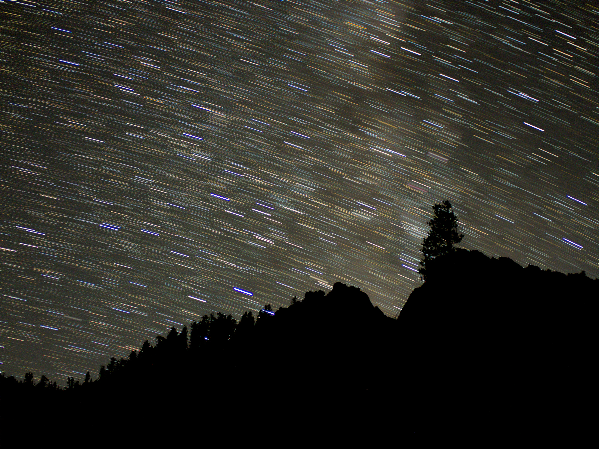
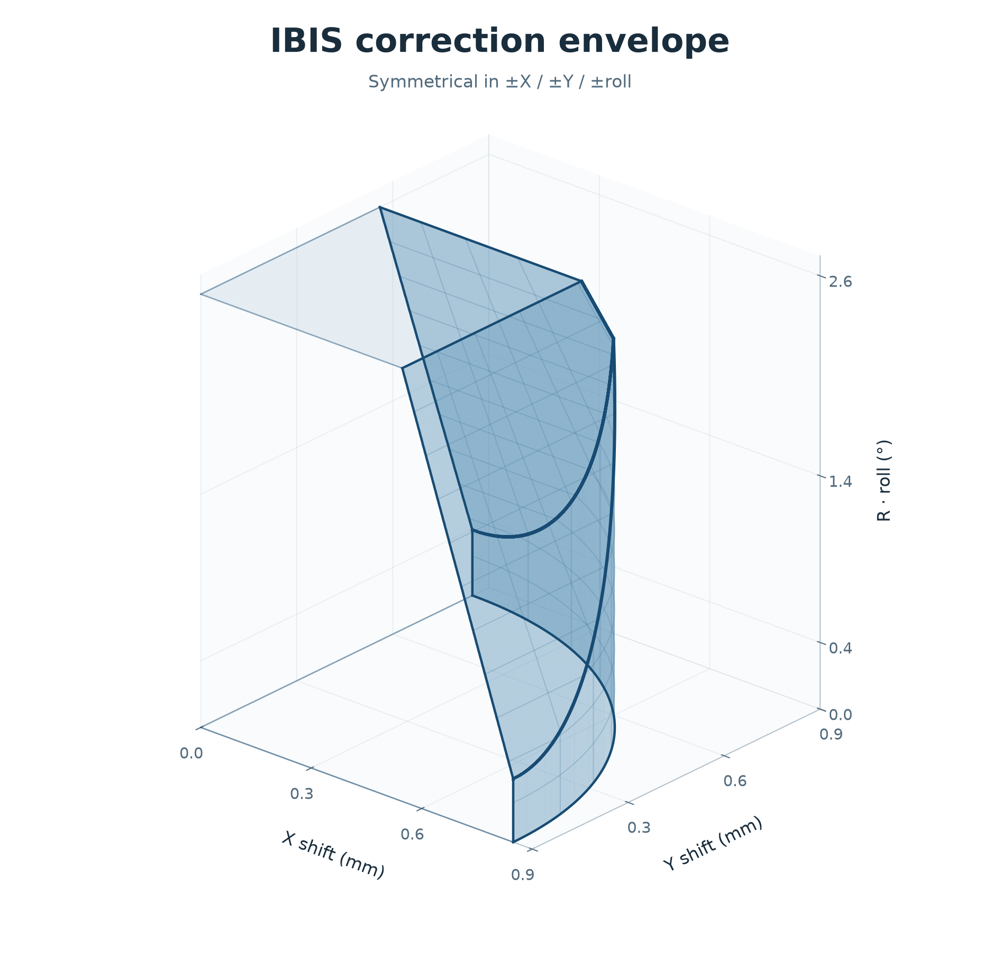
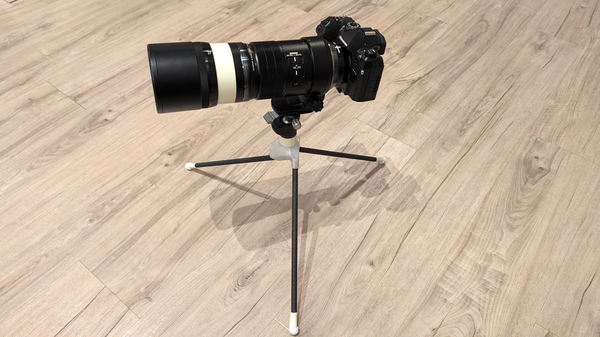
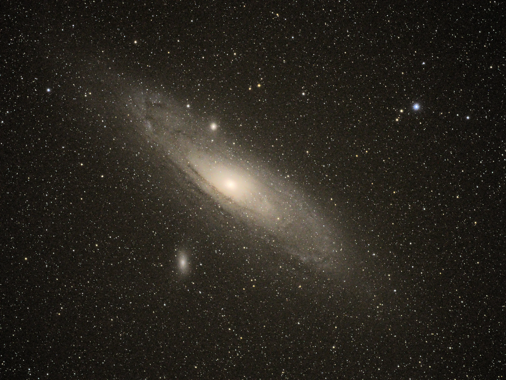
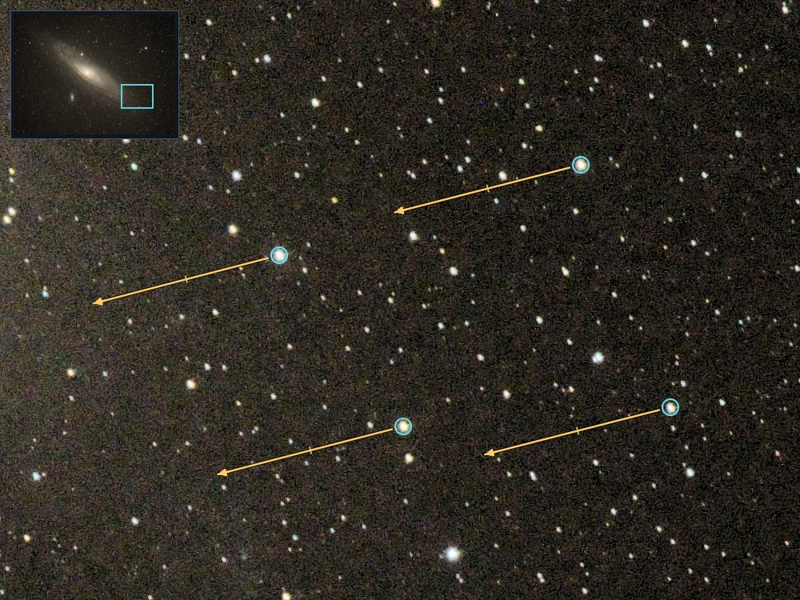

This post describes a firmware patch for the Olympus/OMDS OM-1 (and Mark II) camera that uses the in-body image stabilization actuators to
track the stars in combination with a companion Android app. It works well for both wide-angle astro-landscape shots and
super-telephoto shots with long exposures (tested up to 300 mm, 600 mm FF FOV equivalent).

This blog post was written by me (a human 😁), with some diagrams made with AI. The firmware patch and app were written entirely by AI.

The app and firmware patch are open source [here](https://github.com/kingoflolz/om-startrack).

# Why are Star Trackers Needed?

Annoyingly for astrophotographers (but thankfully for everyone else), the Earth rotates at ~15 degrees per hour. This
causes the stars to move and trail in long exposures (or even short exposures at longer focal lengths).

 Star trails from Upper Twin Lakes, CA. ISO 3200, 25 mm f/2.0, 31 × 10 s stacked exposures (5 min 10 s total exposure).

The standard way to compensate for this is to use an equatorial tracker, which is just a slow motor/gearbox
that, when aligned with the Earth's rotation axis, cancels out the rotation. Trackers are usually pretty heavy and require
a finicky alignment process.

However, a camera should actually be able to do it by itself: the camera can figure out
where it's pointing by taking a photo, and the camera can also physically shift/rotate the sensor for image
stabilization, so the only thing that's missing to put everything together is some software!

(Pentax has a similar version of this called Astrotracer, which uses either GPS/compass/accelerometer data or image analysis
of an uncorrected exposure to determine the camera orientation. However, I think the plate-solving technique described here
requires less setup/calibration and should achieve higher accuracy.)

# Camera Software Architecture

The first step is to figure out how to write my own code to be executed on the camera.
Fortunately, the software update format is relatively straightforward. There is some light scrambling of the update
(the bytes within each 16-byte block have been permuted, and all the bits are flipped), which basically just prevents `strings` from
showing anything interesting. This allows any and all parts of the firmware to be modified.

After decoding, the software architecture is quite clear (if somewhat complicated):

* The main processor uses an MN103 architecture and runs a µITRON RTOS that does almost everything
* A Linux processor with 2 ARM Cortex‑A53 cores, running the Wi-Fi/Bluetooth stack
* A dedicated IBIS processor that also uses MN103 and runs bare-metal code
* A system controller that uses ARM Cortex-M for power management

The main processor and Linux processor are likely on the same chip, as they can communicate through a proprietary message
transport using shared memory and hardware interrupts, but the IBIS processor is likely on a different chip, as it communicates
through a serial link.

Since Linux has the best toolchain and supports fast debugging and iteration (including runtime code reloading), as many of
the camera firmware modifications as possible are concentrated there.

Unfortunately, judging from the firmware update files, the camera doesn't seem to have an independent method for flashing
firmware, as the firmware-flashing code is just a regular main processor task. Thus, the main processor modifications
are kept minimal to reduce the risk of bricking the camera.

# Where is the camera pointing?

It's possible to determine where the camera is pointing with extremely high accuracy by analyzing the stars in the
image and matching them to a large catalogue of stars with known positions. This is called plate solving, and there are
many different implementations of this.

The first step is to take a photo and then figure out where the stars are in the image. A Linux binary performs
streaming RAW decoding and star detection. The main steps are:

* Estimate sky background and noise
* Find bright regions
* Group and screen candidates
* Measure positions

This step is mostly I/O limited. The Linux side doesn't have direct access to the SD card, and the fastest method found
was to use loopback PTP/IP transfer. This stage takes about 2 s after the image is taken and written. Then the camera
sends the top 256 detected points to the phone via Bluetooth.

Once the phone receives the star pixel positions, it first performs lens correction to get corrected rays. Then, it uses
the tetra3 algorithm, which
searches the database for sets of 4 bright stars in the image. The database contains ~70k stars for this stage, stored
by the expected field of view from the capture focal length. Once a match is found, it's validated by matching the
remaining stars against a larger database (~3M). The default database shipped with the app works for anything between
an 8 mm fisheye lens (~180-degree FOV) and a 300 mm telephoto lens (~3-degree FOV) and is only 50 MB. This stage usually
takes less than 20 ms, and it's very rare that the solve fails.

End to end, the whole process takes less than 5 seconds, including capturing the image, detecting stars, Bluetooth
transfer, and plate solving.

# Point to what you want to shoot

Initially, the only way to orient the camera to what you want to shoot was to keep redoing the plate-solving step after
adjusting the camera. That got pretty annoying quickly, especially for lenses with very narrow fields of view, where it
was easy to lose track of where things are and where you need to point. Thankfully, the camera comes with very good
gyroscopes already for image stabilization, and by integrating the gyro readings, it's possible to get highly accurate
real-time camera orientation readings. Over the 20 or so seconds it takes to orient the camera for a new target, the
gyro integration only drifts by fractions of a degree, which is plenty accurate even with a telephoto lens.

# Taking the photo

After the camera is pointed to the right spot, the camera orientation is solved again to get the maximum accuracy.
Then, the phone determines the Earth's rotation rate in the camera reference frame from the plate solve and sends that
as a rate command. Fortunately, there is no need to worry too much about the low-level details, as this rate command
can just be added to the existing IBIS gyro input rates, and this moves the sensor to compensate for the star movement.

The IBIS actuator has 3 degrees of freedom with a coupled-axis architecture. There's a single axis for left/right movement
and two independent up/down actuators, one on each side of the sensor. Driving those differentially
rotates the sensor. The stage position seems to be controlled in a closed loop using Hall sensors.

# Sensor Prepositioning

With the 300 mm lens, the sensor's limited travel range imposes a maximum exposure time that can be as low as
around 20 seconds, depending on the orientation.

To increase the maximum exposure time, the camera sensor can be prepositioned before the exposure begins in the opposite
direction of travel, so the maximum exposure time can be doubled.

# Potential Errors

The long focal lengths of telephoto lenses and the small pixel pitch of the camera make this challenging. With the
300 mm lens, each pixel only spans 2.3 arcseconds (0.00063 degrees!). For scale, the Earth rotates at 15 degrees per hour
(15 arcseconds/s), so there could be more than 6 pixels per second of trailing in an untracked shot.

There are several potential sources of error:

- Lens distortion
- Focal length error
- IBIS tracking error
- Pointing direction error

If there is lens distortion, even if the sensor moves perfectly, it wouldn't be able to collect all the light from a
single star into a single pixel. There's not really any way to solve or reduce this, and this is a fundamental limitation
of any IBIS-based tracking system. Fortunately, the longest lens I have, the Olympus 300 mm f/4, has almost [non-existent distortion](https://www.lenstip.com/478.6-Lens_review-Olympus_M.Zuiko_Digital_300_mm_f_4.0_ED_IS_PRO_Distortion.html).

There is some focal length variation with focus and probably also between different copies of the same lens. The
lens does provide a focal length readout, but using the plate solve, it's possible to get a much more accurate focal
length, which essentially eliminates this term.

Even if we know exactly how to command the sensor to move, there is still likely some error in the mapping between
the Hall sensor feedback and the actual position of the sensor. This term seems to be calibrated in the factory and
is quite accurate.

The last main source of error is uncertainty about where the camera is pointing. If there is an error here, the camera will be
tracking the sky at the wrong rate. To have a subpixel pointing error with the 300 mm lens and 60 seconds of integration,
the pointing error needs to be less than 8 arcminutes (0.14 degrees). This is easily achieved with the plate solve,
which also has a nice advantage: longer focal lengths require higher accuracy, but its accuracy also naturally increases
with focal length.

# Tripod

 Tripod with camera and 300 mm f/4 lens.

One other source of error is the camera not being held perfectly stationary by the tripod. I'm sure you can buy nice
tripods which will do the job, but I wanted a light and compact tripod with very high stiffness. The height and
adjustability of most tripods on the market are counterproductive for this, as holding the camera higher off the ground
makes it more difficult to support, and adjustability means more moving parts and potential for deflection.

I designed a simple tripod made from a ball head, a 3D-printed polycarbonate hub, and short carbon fiber rods press-fit
into the hub. I think it should be the most stable tripod for its weight (210 g total, including the ball head). The
ergonomics of using this are obviously not as good as those of a taller tripod, but adjusting most settings and capturing photos
can be done in the app, so there's no need to use the camera on the tripod too much. All the photos in
this post are captured using this tripod.

[Download the model](https://www.printables.com/model/1919054-lightweight-carbon-fiber-tripod)

# Results

The whole system works quite well! It only takes a minute or so to turn the camera on, focus, and point it at any target in the
sky. It can reliably capture 60-second exposures at 300 mm (IBIS travel permitting) with almost perfectly sharp stars.

 Andromeda from Elephant Butte, NM. ISO 3200, 300 mm f/4.0, 50 s single exposure.
Processed in darktable with astrophoto denoise, chromatic aberration correction, a tone curve, and saturation adjustments.
<a href="/assets/star-tracker/andromeda.png">Full-resolution PNG</a>
<a href="/assets/star-tracker/andromeda.ORF">RAW file</a>

For scale, here's a crop of the original image, showing how far the stars would have moved during the exposure without
tracking.

Screen recording of the app, showing plate solve latency and live pointing feedback from gyro integration.

<video controls playsinline preload="metadata" width="1080" height="2410" aria-label="Star tracker app demo" style="display: block; width: 100%; max-width: 400px; height: auto; margin: 0 auto;">
<source src="/assets/star-tracker/appdemo-av1.mp4" type='video/mp4; codecs="av01.0.12M.10"'>
<source src="/assets/star-tracker/appdemo-compressed.mp4" type="video/mp4">
</video>
